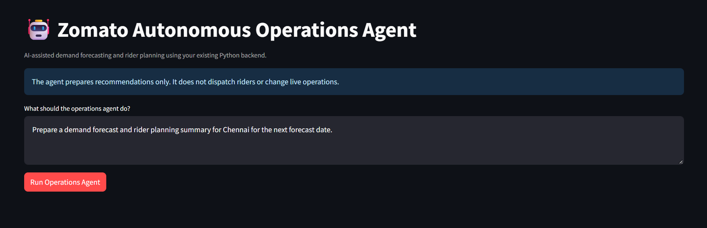
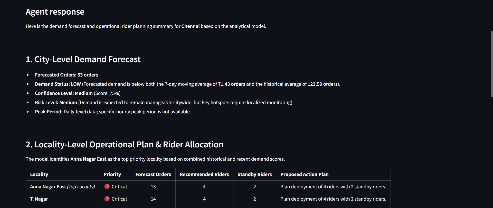
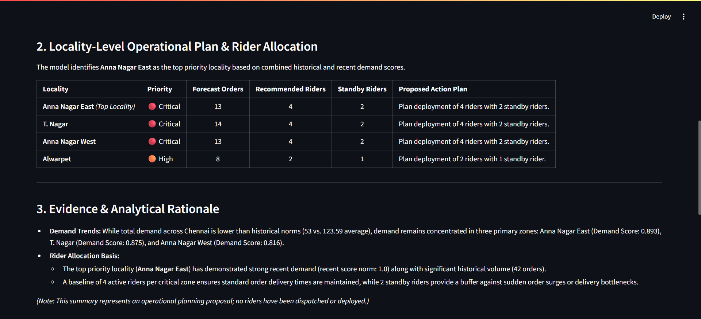
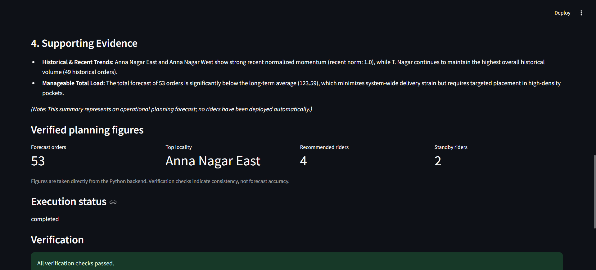
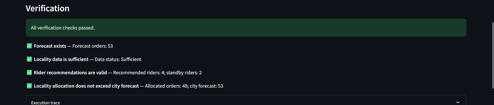

# 🤖 Zomato Autonomous Operations Agent

An AI-powered operations assistant that uses demand forecasting, Python tools, and verification checks to prepare demand summaries and rider planning recommendations.

**Live Demo:** [Try the application](https://zomato-autonomous-operations-agent.streamlit.app/)  
**GitHub Repository:** [View the source code](https://github.com/yaswanth872742/Zomato-Autonomous-Operations-Agent)

---

## 📌 Project Overview

Food delivery operations need to understand demand patterns and plan rider availability across different localities. This project explores how an AI agent can assist with these decisions by connecting a language model to an existing Python analytics backend.

The user provides an operational goal, such as preparing a demand forecast and rider planning summary for a city. The agent uses available tools to retrieve analytical results, interpret the findings, and produce a structured recommendation with supporting evidence.

The application is built using Python, Streamlit, and the Gemini API.

**Important:** The agent prepares planning recommendations only. It does not dispatch riders or modify live delivery operations.

## 🎯 Objectives

- Build an AI agent that can interpret operational requests.
- Connect an LLM to existing Python functions through tool calling.
- Generate city-level demand summaries and locality-level rider recommendations.
- Verify important figures and consistency constraints before presenting the results.
- Provide an interactive interface for exploring operational planning scenarios.

## ⚙️ How It Works

The agent follows a tool-assisted workflow:

1. **Goal interpretation:** Understands the user's operational request.
2. **Tool selection:** Identifies the analytical tools required to answer the request.
3. **Tool execution:** Calls Python functions that access the forecasting and operational analytics backend.
4. **Observation:** Uses the returned results to prepare an operational summary.
5. **Verification:** Checks whether the forecast exists, locality data is sufficient, rider recommendations are valid, and locality allocations do not exceed the city forecast.
6. **Final response:** Presents the planning recommendation, supporting evidence, and verification status.

The language model handles task interpretation and tool orchestration, while the Python backend provides the underlying analytical results.

## 🏗️ System Architecture

```text
User Request
     ↓
Streamlit Interface
     ↓
Gemini LLM Agent
     ↓
Tool Selection and Execution
     ↓
Python Analytics Backend
     ↓
Demand Forecast and Locality Analysis
     ↓
Verification Checks
     ↓
Operational Planning Summary
```

The agent uses the existing analytics backend rather than relying on the language model to invent operational figures.

## ✨ Key Features

### 1. City-Level Demand Forecasting

- Retrieves the forecast for the requested city.
- Compares forecast demand with historical and recent demand averages.
- Presents demand status, confidence information, and operational risk indicators where available.

### 2. Locality-Level Rider Planning

- Identifies localities that require operational attention.
- Presents locality priorities and forecast order counts.
- Recommends active and standby rider allocations based on the existing planning logic.

### 3. Evidence-Based Recommendations

- Uses analytical outputs from the Python backend.
- Explains why certain localities receive higher priority.
- Presents supporting demand trends and planning figures.

### 4. Verification and Execution Trace

- Checks the availability of forecast results.
- Validates locality data sufficiency.
- Checks rider recommendation constraints.
- Verifies that locality-level allocated orders do not exceed the city forecast.
- Displays execution status and verification results.

These checks validate selected consistency rules; they do not independently establish forecast accuracy.

### 5. Operational Safety

The application is designed as a decision-support prototype. It does not connect to a live rider dispatch system and cannot execute real-world delivery operations.

## 🛠️ Technology Stack

| Technology | Purpose |
|---|---|
| Python | Application logic and backend processing |
| Streamlit | Interactive web interface |
| Gemini API | Language model and tool-calling orchestration |
| Pandas | Data loading and analysis |
| NumPy | Numerical operations |
| Joblib | Loading the saved forecasting model |
| Scikit-learn | Machine learning dependencies, where used by the backend |
| GitHub | Source code and version control |
| Streamlit Community Cloud | Application deployment |

## 📂 Project Structure

```text
Zomato-Autonomous-Operations-Agent/
│
├── datasets/
│   └── DATA1_Cleaned.xlsx
│
├── notebooks/
│
├── screenshots/
│   ├── 01-agent-interface.png
│   ├── 02-demand-forecast.png
│   ├── 03-rider-planning.png
│   ├── 04-evidence-and-summary.png
│   └── 05-verification.png
│
├── agent.py
├── agent_app.py
├── agent_tools.py
├── app.py
├── backend.py
├── forecast_model.pkl
├── requirements.txt
├── .env.example
├── .gitignore
└── README.md
```

## 🖥️ Application Screenshots

### 1. Agent Interface

Enter an operational task and ask the agent to prepare a planning summary.



### 2. City-Level Demand Forecast

View forecast orders, demand status, confidence information, and risk indicators.



### 3. Locality-Level Rider Planning

Review locality priorities, forecast orders, and recommended rider allocations.



### 4. Evidence and Summary

Review supporting demand trends and the rationale behind the planning recommendations.



### 5. Verification

Inspect verification results and execution status for the generated plan.



## 🚀 Run Locally

### Prerequisites

- Python 3.11
- A Gemini API key
- Git (optional if downloading the repository as a ZIP)

### 1. Clone the repository

```bash
git clone https://github.com/yaswanth872742/Zomato-Autonomous-Operations-Agent.git
cd Zomato-Autonomous-Operations-Agent
```

### 2. Create a virtual environment

```bash
python -m venv .venv
```

Activate it on Windows:

```powershell
.venv\Scripts\Activate.ps1
```

### 3. Install dependencies

```bash
pip install -r requirements.txt
```

### 4. Configure the API key

Set the `GEMINI_API_KEY` environment variable using your own Gemini API key. If you use a local `.env` file, ensure the application loads it correctly.

For example, in PowerShell:

```powershell
$env:GEMINI_API_KEY = "your_actual_api_key"
```

Never commit your actual API key to GitHub.

### 5. Start the application

```bash
python -m streamlit run agent_app.py
```

Open the local URL displayed in the terminal.

## 🧪 Testing

The agent was manually tested with the following scenarios:

- Preparing a demand forecast and rider planning summary for Chennai.
- Preparing a demand forecast and rider planning summary for Agra.
- Identifying high-priority localities and explaining the supporting evidence.
- Handling a request to dispatch riders immediately, which is outside the application's capabilities.
- Running the deployed application and generating a planning response.

The application also performs internal verification checks on selected planning figures and allocation constraints.

These tests demonstrate basic functional behavior, not comprehensive reliability or predictive model performance. Forecast accuracy requires separate evaluation against actual outcomes.

## ⚠️ Limitations

- Forecast quality depends on the available data and the underlying analytical model.
- Rider allocations are recommendations based on the existing planning logic, not guaranteed optimal staffing decisions.
- The application does not dispatch riders or modify live operations.
- Verification checks assess selected consistency rules rather than forecast accuracy.
- The application depends on API availability, usage limits, and network connectivity.
- The current implementation is a prototype and has not been validated as a production delivery operations system.

## 🔮 Future Improvements

- Evaluate forecast accuracy using suitable historical holdout data and error metrics.
- Add automated tests for tool execution, validation rules, and failure handling.
- Improve recovery from API errors, missing data, and invalid tool responses.
- Add persistent task history and structured execution logs.
- Introduce human approval workflows for operational recommendations.
- Explore integrations with live operational systems, subject to appropriate permissions and safety controls.

## 👨‍💻 Author

Developed as a project exploring AI agents, tool calling, operational analytics, and verification.

**Project Links**

- [GitHub Repository](https://github.com/yaswanth872742/Zomato-Autonomous-Operations-Agent)
- [Live Streamlit Demo](https://zomato-autonomous-operations-agent.streamlit.app/)
